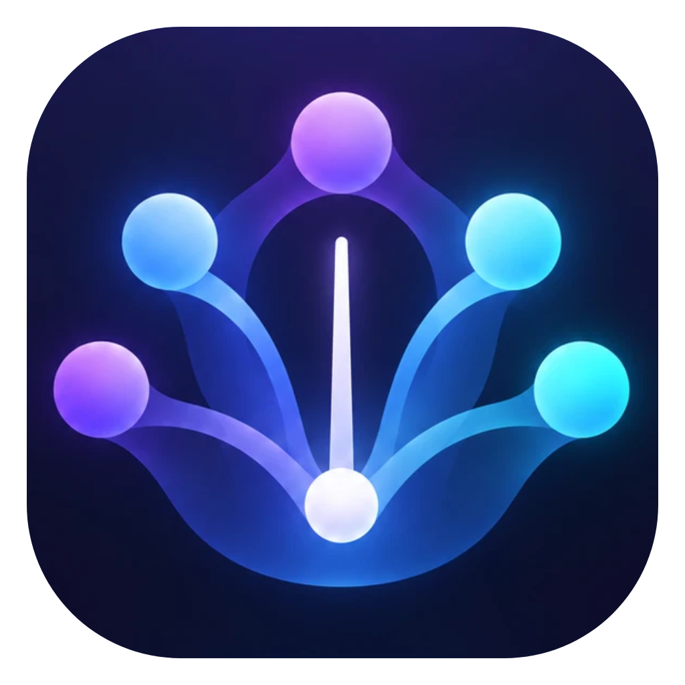

<p align="center">
  
</p>

<h1 align="center">Tutti</h1>

<p align="center">
  Um time de agentes de IA trabalhando junto no seu projeto, num app de desktop para macOS.<br />
  Claude Code, Codex, Antigravity e opencode lado a lado, cada um com o seu papel e o seu mascote 3D.
</p>

---

## Sumário

- [O que é](#o-que-é)
- [O time padrão](#o-time-padrão)
- [Como um pedido funciona](#como-um-pedido-funciona)
- [Perfis: monte o seu time](#perfis-monte-o-seu-time)
- [Skills criadas no Tutti](#skills-criadas-no-tutti)
- [Uso e limites das assinaturas](#uso-e-limites-das-assinaturas)
- [Segurança e privacidade](#segurança-e-privacidade)
- [Instalação](#instalação)
- [Desenvolvimento](#desenvolvimento)
- [Release](#release)
- [Arquitetura](#arquitetura)
- [Documentação de design](#documentação-de-design)
- [Limitações conhecidas](#limitações-conhecidas)

## O que é

Quem programa com IA costuma alternar entre várias ferramentas: o Claude Code para uma coisa, o Codex para revisar, o Gemini para pesquisar, um modelo gratuito para o resto. O Tutti junta todas num lugar só:

- **Um palco 3D** com um mascote por agente, com o estado de cada um ao vivo (disponível, trabalhando, concluído, travado).
- **Pedido direto** a um agente, ou **pedido ao Time**: um coordenador faz a triagem, escolhe quem trabalha, monta um plano quando o pedido é grande e consolida o resultado.
- **Cada pedido tem ponto de restauração**: você vê o diff do que mudou e pode desfazer tudo ou só alguns arquivos.
- **Comandos fora do projeto pedem aprovação**: ler e editar dentro da pasta é livre; o resto passa por você.
- **Conversa contínua**: cada agente retoma a própria sessão e recebe o que os outros já disseram na conversa.
- **Painel de uso** com o quanto falta de cada assinatura, aviso perto do limite e opção de passar o trabalho para outro agente.
- **Perfis**: monte times do zero, com agentes por CLI (assinatura) ou por API (chave de provedor).
- **Skills**: descreva o que quer e um agente escreve, testa e ajusta a skill; depois você escolhe quais agentes a usam.

O app roda as CLIs oficiais que você já tem instaladas e logadas. Ele não guarda nem repassa sua senha de nenhuma delas.

## O time padrão

| Agente | Papel | Ferramenta | Modelo | Escreve? |
|---|---|---|---|---|
| **Bússola** | Coordena: triagem, plano, escolha de quem faz | Claude Code | Opus | sim |
| **Forja** | Back-end, APIs, banco, testes | Claude Code | Sonnet | sim |
| **Pincel** | Front-end, UI, acessibilidade | Claude Code | Sonnet | sim |
| **Radar** | Pesquisa em documentação e referências | Antigravity (`agy`) | padrão da CLI | só lê |
| **Lupa** | Code review, entra no fim | Codex | padrão da CLI | só lê |
| **Curinga** | Tarefas gerais e modelos alternativos | opencode | `opencode/big-pickle` (gratuito) | sim |

Radar e Lupa podem ser **consultados no meio do trabalho**: um agente que está escrevendo pergunta algo a eles e segue com a resposta.

O perfil Padrão é só leitura. Para mudar algo, duplique e edite (veja [Perfis](#perfis-monte-o-seu-time)).

## Como um pedido funciona

### Pedido direto

Escolha um agente nos chips embaixo do palco e escreva. O pedido vai só para ele.

1. O app grava um **ponto de restauração** (o projeto precisa ser um repositório git; se não for, o app oferece criar um).
2. O agente trabalha. Você acompanha cada passo no painel da direita.
3. Ao terminar, aparece o **diff**. Você pode **Desfazer** tudo ou só arquivos escolhidos.

Há um pedido por vez por projeto. Os outros entram na fila.

### Pedido ao Time

Com o chip **Time** escolhido, o coordenador do perfil (o Bússola, no Padrão):

1. **Faz a triagem**: dá uma nota de quanto cada agente combina com o pedido e escolhe os candidatos.
2. **Confirma com os candidatos**: cada um responde em uma frase se assume, assume com ajuda ou passa.
3. **Escala o time**: decide quem faz o quê, em que ordem e com qual modelo.
4. **Monta um plano** quando o pedido é grande, ou quando você marca **forçar plano**. Você aprova ou recusa antes de qualquer coisa rodar.
5. **Executa em ondas**: quem não depende de ninguém roda primeiro; quem revisa (a Lupa) entra no fim.
6. **Consolida** o resultado num diff só, com ponto de restauração do pedido inteiro.

**Rodada completa** faz todos os agentes disponíveis responderem no passo 2, não só os candidatos da triagem.

### Durante o trabalho

- **Aprovação de comandos**: ler e editar arquivos dentro do projeto é livre. Comando de shell que mexe fora da pasta, escreve em `.git/` ou usa recursos do shell que não dá para analisar pede a sua aprovação num cartão.
- **Perguntas**: o agente pode parar e te perguntar algo em texto livre.
- **Cancelar**: interrompe o agente; o ponto de restauração continua valendo.

### Instruções que os agentes recebem

Além da persona de cada agente, entram só as suas instruções:

- `~/.claude/CLAUDE.md` e `~/.codex/AGENTS.md` (globais)
- `CLAUDE.md` e `AGENTS.md` na raiz do projeto

Plugins, hooks, MCP e configurações pessoais das CLIs **não** entram.

## Perfis: monte o seu time

Em **👥 → Configurar perfis…** você cria perfis do zero ou duplica o Padrão. Cada projeto lembra o perfil que você escolheu.

- **Até 8 agentes** por perfil, cada um com nome, função, instruções e papel: *só lê*, *revisor* (entra no fim do Time) ou *pode ser consultado*.
- **Coordenador** opcional; sem coordenador, o perfil só aceita pedidos diretos.
- **Transporte por agente**, ou um padrão do perfil:
  - **CLI**: Claude Code, Codex, Antigravity ou opencode, usando a sua assinatura. Pela CLI do opencode, só modelos gratuitos (`opencode/…`).
  - **API (chave)**: OpenRouter, Kimi (Moonshot), OpenAI, Anthropic, Google ou DeepSeek, rodando pelo opencode embutido. Escolha o provedor e o modelo da lista.
- **Mascote pela família do modelo**: Claude, GPT, Gemini ou outro, com tons diferentes quando há vários da mesma família.

### Chaves de API

Em **Configurar perfis… → Chaves de API**:

- A chave fica criptografada pelo **Keychain do macOS** e só vai para o processo do opencode, num arquivo temporário com permissão `0600`. Ela nunca aparece na interface, em logs, no banco em texto claro nem no ambiente das CLIs.
- **API é cobrada por uso.** No Time, todo passo com agente por API exige que você aprove o plano. Agentes por API não são consultados no meio do trabalho.

Para usar DeepSeek ou Kimi: salve a chave, crie um agente com **Transporte = API (chave)**, escolha o provedor e o modelo, e selecione o perfil no 👥.

## Skills criadas no Tutti

Em **👥 → Skills…**:

1. **Nova skill**: descreva o que a skill deve fazer e escolha **quem cria**.
2. O agente escreve o `SKILL.md` (nome, *quando usar* e instruções em passos). Você pode editar tudo.
3. **Testar**: escreva uma tarefa de exemplo e escolha quem testa. O teste roda só leitura, no projeto aberto.
4. **Ajustar**: quem criou recebe a resposta do teste (e o seu comentário, se houver) e corrige a skill. Sem comentário, ele mesmo avalia se a resposta seguiu a skill.
5. **Usada por**: marque os agentes, de qualquer perfil, e clique em **Salvar skill**.

Como cada agente recebe as skills:

- **Claude Code**: como plugin local do Agent SDK (`tutti:<nome>`). O agente só abre a skill quando a tarefa combina com o *quando usar*.
- **Codex, Antigravity, opencode e agentes por API**: junto com as instruções do agente.

Nada é gravado em `~/.claude`, `~/.codex` nem no seu projeto. Criar, testar e ajustar contam no painel de uso. Com agente por API paga, o botão mostra *(API paga — Provedor)* e o clique é a confirmação.

## Uso e limites das assinaturas

O painel **Uso**, no canto do palco, mostra por ferramenta os tokens gastos e a porcentagem do limite:

- **Claude Code**: limites reais da assinatura (janelas de 5 horas e semanal), lidos do Agent SDK.
- **Codex**: lidos dos registros de sessão locais do Codex.
- **Antigravity e opencode**: estimativa pelos tokens do dia, com teto configurável.
- **API (paga)**: tokens dos agentes por API.

Clique numa linha para ver o detalhe por pedido e por dia e ajustar o aviso (padrão: **90%**, também por ferramenta).

Quando uma ferramenta passa do aviso com um agente trabalhando, aparece um cartão: **Passar** troca o trabalho para outro agente com folga, mantendo o que já foi feito; **Continuar** segue como está.

## Segurança e privacidade

- As CLIs rodam com a **configuração pessoal isolada**: sem plugins, hooks, MCP nem skills dos seus diretórios; só as instruções listadas acima.
- **Chaves de API** de provedores são removidas do ambiente de todas as CLIs. As chaves salvas no app ficam no Keychain e só chegam ao opencode.
- **Consultas** (Radar, Lupa, criar/testar skill) rodam em modo só leitura em todas as ferramentas.
- Tudo fica **local**: conversas, eventos, uso e configurações num SQLite na pasta de dados do app.

| Onde | O quê |
|---|---|
| `~/Library/Application Support/Tutti/` | dados do app instalado |
| `~/Library/Application Support/time-de-agentes/` | dados do app em desenvolvimento (`npm run dev`) |
| `…/time.db` | banco SQLite (projetos, conversas, pedidos, uso, perfis, skills, chaves criptografadas) |
| `…/skill-plugins/<agente>/<versão>/` | plugin de skills de cada agente Claude |
| `…/skill-work/` | pasta vazia onde as skills são criadas |
| `refs/time/runs/<id>/…` no repositório do projeto | pontos de restauração (refs git, sem commits no seu branch) |

## Instalação

### Requisitos

- **macOS** (Apple Silicon ou Intel).
- **git**.
- As ferramentas que o seu perfil usa, instaladas e logadas:

| Ferramenta | Comando | Observação |
|---|---|---|
| Claude Code | `claude` | o Agent SDK do app usa a sua assinatura |
| Codex | `codex` | o SDK do app traz o binário; precisa estar logado |
| Antigravity | `agy` | login em `~/.gemini/antigravity-cli/` |
| opencode | `opencode` | modelos `opencode/*` funcionam sem login |

O app procura as CLIs também em `~/.local/bin`, `~/.opencode/bin` e nas pastas do Homebrew. Agente sem ferramenta pronta aparece travado no palco, com a dica do que falta.

### Pelo `.dmg`

1. Baixe o `.dmg` da [última release](https://github.com/natan1506/project-tutti/releases): `arm64` para chip Apple, `x64` para Intel.
2. Abra o `.dmg` e arraste o **Tutti** para **Aplicativos**.
3. Na primeira abertura o macOS pode bloquear, porque o app tem assinatura *ad-hoc* (sem Apple Developer ID). Libere em **Ajustes do Sistema → Privacidade e Segurança → Abrir Mesmo Assim**.

### Pelo código

```bash
npm ci
npm run install-app
```

Isso gera o `.app` e copia para `/Applications/Tutti.app`, substituindo o que estiver lá.

### Atualizações

O app instalado confere a última release no GitHub 15 s depois de abrir e a cada 6 horas, e mostra um aviso com o botão **Baixar**. Enquanto o repositório for privado, essa consulta não tem acesso e o aviso não aparece.

## Desenvolvimento

Stack: **Electron 45**, **electron-vite**, **React 19**, **TypeScript**, **zustand**, **React Three Fiber**, **vitest**, `node:sqlite`, **zod**, **Playwright** para os testes no app real.

```bash
npm ci            # instala; também troca o nome "Electron" por "Tutti" no Dock em dev
npm run dev       # app em modo desenvolvimento, com recarga
npm test          # testes (vitest)
npm run typecheck # TypeScript
npm run build     # gera out/
npm run package   # gera o .dmg em release/
```

### Testes no app real

Os scripts em `scripts/e2e/` abrem o Electron de verdade com Playwright e salvam prints. Eles chamam as CLIs de verdade, então gastam um pouco de uso. Exemplo:

```bash
npm run build
node scripts/e2e/verify-skills.mjs docs/superpowers/verificacao-skills
```

Os resultados de cada fase estão em `docs/superpowers/verificacao-*/`.

### Spikes

`scripts/spike/` tem os experimentos que confirmaram como cada SDK e CLI se comporta antes de cada fase (resumos em `docs/superpowers/spike-*.md`).

### CI

`.github/workflows/ci.yml` roda `tsc` e `vitest` no macOS a cada push na `main` e em pull requests.

## Release

1. Suba a versão: `npm version X.Y.Z --no-git-tag-version` e faça o commit.
2. Envie a `main` e crie a tag:

```bash
git push origin main
```

```bash
git tag vX.Y.Z && git push origin vX.Y.Z
```

O workflow `.github/workflows/release.yml` confere se a tag bate com a versão do `package.json`, roda os testes e gera os `.dmg` **arm64** e **x64**, publicando os dois na release do GitHub.

O app não usa ASAR (os SDKs executam binários de `node_modules`) e é assinado *ad-hoc* por `build/adhoc-sign.cjs`.

## Arquitetura

```
src/
├── main/                    processo principal (Node)
│   ├── adapters/            uma por ferramenta: claude, codex, antigravity, opencode
│   ├── runs/                ciclo de um pedido: fila, ponto de restauração, agente, diff
│   ├── team/                pedido ao Time: triagem, plano, ondas, consultas entre agentes
│   ├── profiles/            perfis e agentes removidos
│   ├── skills/              criar/testar/ajustar skills e o plugin dos agentes Claude
│   ├── usage/               uso, limites e troca de agente perto do limite
│   ├── keys/                chaves de API no Keychain
│   ├── policy/              o que roda sozinho e o que pede aprovação
│   ├── git/                 pontos de restauração, diff e desfazer
│   ├── context/             o que cada agente recebe da conversa
│   ├── instructions/        CLAUDE.md / AGENTS.md
│   ├── store/               SQLite
│   ├── tools/               detecção das CLIs
│   ├── updates/             aviso de versão nova
│   └── ipc.ts               ponte com a interface (entradas validadas)
├── preload/                 API `window.time` exposta à interface
├── renderer/                interface React
│   ├── components/          chat, cartões (aprovação, plano, diff, limite), perfis, skills
│   ├── stage/               palco 3D e mascotes
│   └── state/               stores zustand
└── shared/                  tipos e regras usados dos dois lados (agentes, perfis, skills, uso)
```

Cada ferramenta tem um **adaptador** com a mesma interface (`run(opts) → eventos`): texto, ferramenta usada, arquivo alterado, uso, limite, fim. O resto do app não sabe qual CLI está por trás.

## Documentação de design

- `docs/superpowers/specs/2026-10-30-time-de-agentes-design.md`: design original (elenco, fluxo, segurança, interface).
- `docs/superpowers/specs/2026-11-01-custos-e-perfis-design.md`: uso, limites e perfis.
- `docs/superpowers/plans/`: o plano de cada fase.
- `docs/mockups/`: mockup aprovado da tela principal.

## Limitações conhecidas

- Só macOS.
- Sem assinatura Apple Developer: a primeira abertura precisa de liberação manual, e não há atualização automática (só o aviso com link).
- O aviso de versão nova não funciona enquanto o repositório for privado.
- Ainda não implementado do design original: rodada de testes com correção automática, correção a partir da revisão da Lupa e notas/caderno de lições por pedido.
- Skills são só texto (`SKILL.md`), sem scripts nem arquivos extras.

---

Feito por Natan Souza.
